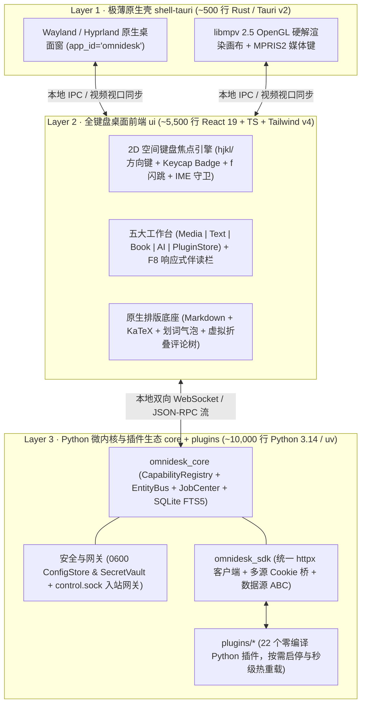

# 万象 · OmniDesk（v2）：极简三层架构 + 全键盘空间交互 + 零 ABI 纯 Python 插件体系

## 一、核心设计哲学与防膨胀铁律

OmniDesk v2 彻底告别 v1 时期「18 万行 C++17 Borealis 手搓 UI + 22 个独立 CMake `.so` 二进制插件仓 + 头文件哈希连坐重编」的历史包袱，转向**总代码量严格控制在 `~16,000` 行以内**的现代三层架构：

1. **零二进制插件 ABI（JSON / Pydantic 契约即唯一边界）**：
   - 彻底废除 C++ `.so` 动态库、`dlopen`、`OMNIDESK_DECLARE_PLUGIN`、`sdk_abi_signature` 编译期指纹与 `DsoViewLease`。
   - 所有站点接入、AI 路由、NAS 连接、字幕/电子书/PDF 处理与策展逻辑全部采用 **纯 Python（`3.14+`，`uv` 管理）** 编写，仅通过 `CapabilityRegistry`（版本化 JSON/Pydantic RPC）与 `EntityBus`（主题事件）解耦协作——改内核永不破坏插件，保存 `.py` 秒级热重载。
2. **「键盘控制一切」的一等公民桌面体验**：
   - 完整继承并升级 **Paper `#F6F5F3`（纸感亮色）& Graphite `#181718`（石墨深色）** 视觉系统与无遮罩 `F8` 伴读栏。
   - 前端内置 **二维空间焦点引擎（2D Spatial Focus Engine）**：焦点绑定在稳定的业务 `item.id` 上（异步刷新绝不丢焦点），任何时刻都有清晰焦点环；支持 `h/j/k/l` 与方向键跨分栏几何跳转、显式键帽角标（`Ctrl+1..5` 工作台、确定性 `Alt+字母` 插件页、`f` 全屏字母闪跳、`Ctrl+K` 命令面板、`F8` 伴读抽屉），并在 Fcitx5 / Rime 中文输入 `isComposing` 期间自动避让单键快捷键。
3. **原生硬解不妥协，富文本排版不造轮子**：
   - 视频与无损音频由极薄原生壳内嵌 **`libmpv` OpenGL 硬解画布（`hwdec=auto-safe`）** 驱动，画质、帧率与系统媒体键（MPRIS2）100% 原生。
   - 双语文章、LaTeX 公式（KaTeX）、代码块高亮、可折叠嵌套评论树、EPUB/PDF 划词气泡（Selection API）直接交由现代 Web 排版引擎原生承载，不再手搓几千行 NanoVG 文本测量与纹理缓存。
4. **四条硬性代码规模红线（防止人类与 AI 维护失控）**：
   - **单文件上限 `<= 400` 行**：任何 `.py` / `.tsx` / `.ts` / `.rs` 文件超过 400 行必须按职责拆分，严禁出现数千行的大泥球状态机。
   - **原生层零业务逻辑**：`shell-tauri/`（Rust）总计不超过 `~500` 行，只负责 Wayland 窗口与 `libmpv` 帧渲染，写完即封存。
   - **单仓收编 + 公共底座复用**：22 个核心与社区插件统一收编进仓库 `plugins/<plugin-id>/`（仍支持外部 Git 插件按需安装），HTTP 重试、代理隔离、Cookie 读取与缓存统一收口至 `omnidesk_sdk`（`~400` 行），严禁在各插件内重复造网络与解析轮子。
   - **兄弟项目活体同源引用**：直接 `import` 本机 `/home/zhu/Projects/qwen-translator` 的成熟 Python 模块（双语歌词、字幕、网页/PDF 翻译、Codex/Antigravity 会话），修一处两端同时受益。

---

## 二、总体三层架构图

### 代码预算表（目标总量 `~16,000` 行，较 v1 缩减 `91%`）

| 层级 | 目录 | 技术栈 | 目标行数 | 核心职责边界 |
| :--- | :--- | :--- | :---: | :--- |
| **原生壳** | `shell-tauri/` | Rust + Tauri v2 + `libmpv` | `~500` | Wayland 窗口管理、`libmpv` GPU 硬解视口同步、MPRIS2 媒体控制 |
| **全键盘前端** | `ui/` | React 19 + TypeScript + Tailwind v4 | `~5,500` | Paper/Graphite 主题、2D 空间焦点导航、四大领域工作台、插件市场表单与 `F8` 伴读栏 |
| **Python 内核与 SDK** | `core/` | Python 3.14 (`uv` / `asyncio` / Pydantic / SQLite FTS5) | `~2,500` | 插件生命周期、能力注册表、事件总线、任务中心、`0600` 密钥库、`control.sock` 与 `omnidesk-pm` CLI |
| **插件群（22 个）** | `plugins/` | Python 3.14 (`httpx` / `selectolax` / 活体复用) | `~7,500` | 每个插件 `150~350` 行：站点抓取解析、Magpie 路由、飞牛 NAS、ASR、策展回灌与歌单同步 |

---

## 三、插件矩阵与松耦合协作模型

平台将插件分为 **能力底座（`provider`）**、**领域工作区（`workspace` / `hybrid`）** 与 **扩展（`extension`）**，严禁插件间直接硬编码互引，一律经由 `CapabilityRegistry` 与 `EntityBus` 协作（装了即联动，停用自动优雅降级）：

| 插件 ID | 类型 | 域 | 职责边界 | 提供 / 消费的标准能力 |
| :--- | :--- | :--- | :--- | :--- |
| `plugin-magpie-agent` | `provider` | `core` | 探测本机 Magpie（`127.0.0.1:3425`）Harness/模型/配额，通过专属组 `group/omnidesk-active` 反向打穿路由，驱动内驻 AI 对话与策展 | **提供** `llm.router.v1`, `ai.agent.v1`, `ai.curation.v1`, `llm.chat.v1`, `llm.translate.v1` |
| `plugin-ai-curator` | `hybrid` | `core` | 克隆同步 `obsidian-vault` 与 `music-daily` 回灌全量历史推荐，硬隔离 `daily_immutable` 与 `interactive_ephemeral` 双模前端反写 | **提供** `recommend.feed.v1`, `media.source.v1`, `text.source.v1`, `book.source.v1` |
| `plugin-asr-funasr` | `provider` | `core` | 本地 Vulkan/CPU `FunASR SenseVoiceSmall` 独立子进程分块离线转写与断点续传 | **提供** `speech.asr.v1` |
| `plugin-sub-hunter` | `provider` | `media` | SubHD / ASSRT 字幕检索安全解压与 `ffsubsync` 自动音轨对齐 | **提供** `subtitle.fetch.v1`, `subtitle.sync.v1` |
| `plugin-sponsorblock` | `extension` | `media` | Bilibili (`bsbsb.top`) / YouTube (`sponsor.ajay.app`) K-匿名空降与恰饭片段标记跳过 | **提供** `player.timeline.v1` |
| `plugin-chrome-web` | `hybrid` | `text` | 托管纯净 Chrome `--app` 阅读/登录窗 + 自动注入 MV3 网页双语翻译与同源请求/下载接管扩展 | **提供** `web.embed.v1`, `web.cookies.v1`, `web.extract.v1`, `web.fetch.v1`；消费 `llm.translate.v1` |
| `plugin-music` | `hybrid` | `media` | 直接复用 `qwen-translator` Apple Music / 双语歌词能力 + 国区曲库预检 + `ChatGPT Daily 5` 门禁写回 | **提供** `media.source.v1`, `media.playlist.v1`；消费 `llm.translate.v1` |
| `plugin-bilibili` | `workspace` | `media` | 推荐/动态/追番/直播、4K 流解析、扫码鉴权与弹幕/双语字幕联动 | **提供** `media.source.v1`；可选消费 `speech.asr.v1`, `player.timeline.v1`, `llm.chat.v1` |
| `plugin-youtube` | `workspace` | `media` | 订阅/搜索/频道、`yt-dlp` 流解析与边播边预译双语字幕 | **提供** `media.source.v1`；可选消费 `speech.asr.v1`, `player.timeline.v1`, `llm.translate.v1` |
| `plugin-fnos-nas` | `hybrid` | `media` | 用户自配置挂载目录原盘硬解、受保护双语字幕原子写回、美剧台词切片跳播与阅读进度同步 | **提供** `nas.connection.v1`, `media.local_match.v1`, `media.clip_jump.v1`, `book.sync.v1` |
| `plugin-arr-imdb` | `workspace` | `media` | IMDb 榜单/详情 + Radarr / Sonarr 选片核验与下载队列管理 | 消费 `media.local_match.v1` |
| `plugin-pdf-babeldoc` | `hybrid` | `book` | 基于 BabelDOC 的本地 PDF 版面识别、术语锁定与左右双栏对照生成 | **提供** `book.source.v1`, `book.bilingual_pdf.v1`；消费 `llm.translate.v1` |
| `plugin-ebook` | `hybrid` | `book` | `.epub`/`.mobi`/`.azw3`/`.txt` 分页伴读、点词词源、长难句精读与 SM-2 间隔重复生词本 | **提供** `book.source.v1`, `vocab.sm2.v1`；可选消费 `media.clip_jump.v1`, `book.sync.v1` |
| `plugin-zlib` / `annas-archive` | `hybrid` | `book` | Z-Library / Anna's Archive 搜书下载，完成后一键转交 BabelDOC、EPUB 书架或飞牛 NAS | **提供** `book.search.v1`；消费 `book.bilingual_pdf.v1`, `book.sync.v1`, `web.cookies.v1` |
| `plugin-zhihu` / `linuxdo` / `shuiyuan` / `v2ex` / `reddit` / `x` / `journals` | `workspace` | `text` | 各社区与科学期刊高信噪比信息流、公式代码块保真解析与可折叠评论树 | **提供** `text.source.v1`；消费 `web.cookies.v1`, `web.fetch.v1`, `llm.translate.v1` |
| `plugin-blog` / `feed-recipe` | `hybrid` | `text` | 博主式个人博客订阅 + 20 行声明式 JSON 站点配方引擎 | **提供** `text.source.v1`, `blog.subscription.v1`, `feed.recipe.v1` |

---

## 四、`plugin-chrome-web`：为什么继续坚持「托管真 Chrome `--app` + MV3 扩展」？

对于重度反爬登录（Cloudflare Turnstile、jAccount SSO、2FA）以及出版商复杂交互网页阅读，托管系统原生 Chrome 比在应用内塞重型浏览器爬虫更干净：

1. **免商店签名直载 MV3 扩展**：通过 `--user-data-dir=~/.local/share/omnidesk/chrome-profile --load-extension=<ext-dir> --app=<url> --class=omnidesk-reader` 拉起无地址栏纯净阅读窗，随系统自动更新且完美兼容 Wayland / Hyprland 分屏规则与 Fcitx5 输入法。
2. **零配置自动配对与兄弟仓库同源**：OmniDesk Python 内核直接复用 `/home/zhu/Projects/qwen-translator` 的网页翻译服务与跨浏览器 MV3 扩展源码，启动时自动注入回环端口与当次 Bearer Token，打开论文按 `Alt+Shift+T` 即刻双语对照并保护上标引用 `[1]` 与数学公式。
3. **统一会话与下载回流底座**：在真实浏览器完成一次登录后，通过 `web.cookies.v1` / `web.fetch.v1` 反哺社区插件；页面点击 PDF/EPUB 下载自动归入 OmniDesk 书架或 BabelDOC 翻译队列。

---

## 五、迁移与演进路线图（v1 C++ → v2 Python + React + Tauri）

> 注：仓库当前根目录下的 `host/`、`sdk/`、`pm/` 为已冻结的 v1 C++17 参考实现（可在归档分支 `legacy-cpp` 留存对照），新功能开发与插件迁移一律按以下 v2 阶段推进：

1. **Stage 1：v2 核心骨架与全键盘空间工作台闭环**
   - 建立 `shell-tauri/`（Wayland 原生窗 + `libmpv` 硬解嵌入）、`ui/`（Paper & Graphite 主题 + 2D 空间键盘焦点引擎 + 五大工作台骨架 + `F8` 伴读栏）与 `core/`（`omnidesk_core` + `omnidesk_sdk` + `control.sock` + 热重载插件加载器）。
2. **Stage 2：核心底座与双模 AI 策展率先就位**
   - 迁移 `plugin-magpie-agent`、`plugin-ai-curator`（双仓历史回灌 + 每日/交互双模隔离）与 `plugin-music`（直接复用 `qwen-translator` 的 `music_adam.py` / `music_lyrics.py` + Apple Music 写回门禁）。
3. **Stage 3：文字社区、科学期刊与书本伴读工作台成型**
   - 接入原生 Markdown + KaTeX + 划词气泡 + `CommentTreeView`，将 `chrome-web`、`ebook`、`pdf-babeldoc`、`zlib`、`annas-archive` 及各社区插件收敛为每个 `150~300` 行的精简 Python 插件。
4. **Stage 4：影视源与飞牛 NAS 完整收官并退役 v1 C++ 树**
   - 迁入 `fnos-nas`、`bilibili`、`youtube`、`sub-hunter`、`sponsorblock`、`asr-funasr`、`arr-imdb`，全套 `pytest` + `vitest` 绿灯后清理根目录下旧版 CMake / C++ 代码。
