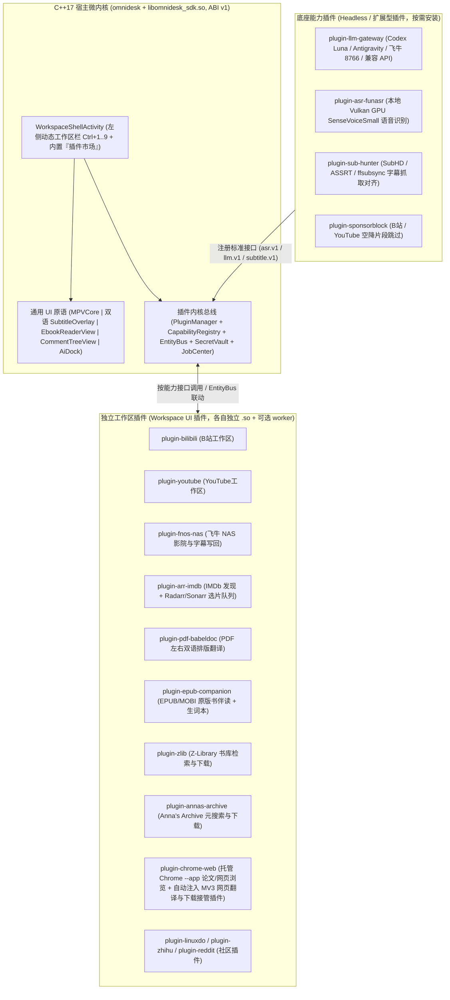

# 万象 · OmniDesk：全插件化微内核 + 插件市场 + 上游持续跟进架构

## 一、核心设计哲学：一切皆插件（宿主微内核 + 插件市场）

宿主（`omnidesk` + `libomnidesk_sdk.so`）只保留**纯粹的渲染、窗口、键盘焦点树、通用组件（`MPVCore` / `EbookReaderView` / `CommentTreeView`）以及插件运行时与总线**，**不包含任何具体站点、具体翻译模型、具体网盘或具体文档引擎的业务代码**。

连 B 站、飞牛 NAS、PDF 翻译、Chrome 论文/网页双语浏览、本地语音识别在内，全部以独立插件包（`plugins/<plugin-id>/plugin.json`）形态存在，由内置的 **「插件市场与更新中心（Plugin Store）」** 统一安装、启停、配置密钥和追踪上游更新。

---

## 二、插件分类与解耦交互模型

平台将插件分为两类正交形态，通过 **`CapabilityRegistry`（能力注册表）** 与 **`EntityBus`（跨插件实体总线）** 松耦合协作——装了就能联动，卸了自动优雅降级，绝不硬编码互相依赖：

### 插件清单矩阵（每个插件均可单独开关、独立升级、独立卸载）

| 插件 ID | 类型 | 职责边界 | 提供 / 消费的标准能力 |
| :--- | :--- | :--- | :--- |
| `plugin-llm-gateway` | 能力底座 | 统一封装本机 `codex` (`gpt-6-luna`)、`Antigravity`、飞牛 `8766` 与兼容 API 会话池 | **提供** `llm.chat.v1`, `llm.translate.v1` |
| `plugin-asr-funasr` | 能力底座 | 本地 Vulkan GPU `FunASR SenseVoiceSmall Q8` 离线/分块语音转写（不装不占显存与模型空间） | **提供** `speech.asr.v1` |
| `plugin-sub-hunter` | 能力底座 | SubHD 浏览器抓取、ASSRT API、`ffsubsync` 自动音轨/参考轴对齐 | **提供** `subtitle.fetch.v1`, `subtitle.sync.v1` |
| `plugin-sponsorblock` | 播放器扩展 | 为任意声明了视频 ID 的播放器注入进度条空降色块与 `F9` 跳过 | **扩展** `player.timeline.v1` |
| `plugin-chrome-web` | **工作区 + 浏览器能力** | **彻底抛弃 Zen/Firefox XPI 签名折腾**：将现有出版商论文级网页翻译扩展迁为标准 **Chrome MV3 扩展**；工作区内管理论文链接/外刊书签/浏览会话，点击即拉起无地址栏干扰的托管 **Chrome `--app` 阅读窗**（自动 `--load-extension`、自动注入 `127.0.0.1:8766` 免手动配对、接管 PDF/EPUB 下载、划词送伴读） | **提供** `web.open_and_translate.v1`, `download.browser_intercept.v1`；消费 `llm.translate.v1` |
| `plugin-bilibili` | 工作区 | 推荐/动态/我的/番剧/直播、Android 4K、双扫码 | 消费 `llm.v1`, 可选消费 `speech.asr.v1`, `player.timeline.v1` |
| `plugin-youtube` | 工作区 | 订阅/搜索/频道、`yt-dlp` 流解析、边播边预译双语字幕 | 消费 `llm.v1`, 可选消费 `speech.asr.v1`, `player.timeline.v1` |
| `plugin-fnos-nas` | 工作区 + 能力 | `/mnt/feiniu-smb` 原盘内嵌 `MPVCore` 硬解播放、飞牛 `8765` 接口、`nas_io` 安全防覆盖写回 | **提供** `media.local_match.v1`, `media.clip_jump.v1`；消费 `subtitle.*`, `llm.v1` |
| `plugin-arr-imdb` | 工作区 | IMDb 榜单/详情 + Radarr (`7878`) / Sonarr (`8989`) 做种分档选片与 qBittorrent 队列管理 | 探测 `media.local_match.v1`（已入库直接调飞牛播，未入库一键下发 Arr） |
| `plugin-pdf-babeldoc` | 工作区 + 能力 | 基于 BabelDOC 的本地 PDF 版面识别、术语提取、页码范围选择与左右对照 `dual.pdf` 生成 | **提供** `doc.translate.pdf.v1`；消费 `llm.v1` |
| `plugin-epub-companion` | 工作区 + 能力 | `.epub`/`.mobi`/`.azw3`/`.txt` 分页伴读、点词词源、前后段语境精读、SM-2 生词本、飞牛双端进度同步 | **提供** `doc.open.ebook.v1`；若检测到 `plugin-fnos-nas` 则激活「美剧台词一键跳播原片片段」 |
| `plugin-zlib` | 工作区 + 能力 | Z-Library EAPI 搜书、域名自检、登录态/Cookie 认证、已下载书架管理，遇人机验证可交由 `plugin-chrome-web` 处理并投递给 BabelDOC 或 NAS | **提供** `book.search.v1`, `zlib.library.v1`；消费 `book.bilingual_pdf.v1`, `book.sync.v1`, `nas.connection.v1`, `web.embed.v1`, `web.extract.v1` |
| `plugin-annas-archive` | 工作区 + 能力 | Anna's Archive 元搜索、Fast Download API 与慢速/外部镜像解析，下载完成后投递给 BabelDOC、EPUB 书架或 NAS | **提供** `book.search.v1`, `annas.archive.v1`；消费 `book.bilingual_pdf.v1`, `book.sync.v1`, `nas.connection.v1`, `web.embed.v1`, `web.extract.v1` |
| `plugin-linuxdo` / `zhihu` / `reddit` | 工作区（各独立） | 帖子列表与评论树原生浏览；遇复杂外链论文/文章一键交给 `plugin-chrome-web` 打开并双语翻译 | 消费 `llm.translate.v1`, `web.open_and_translate.v1` |
| `plugin-feed-recipe` | 工作区 + 能力 | 20 行声明式 JSON/Lua 轻量源配方引擎，免编译接入 HN / V2EX / 学者 Blog / 顶会论文列表，自动复用 `plugin-chrome-web` 登录 Cookie 过验证并注入纸白双语排版与折叠评论树 | **提供** `text.source.v1`, `text.comments.v1`, `feed.recipe.v1`；消费 `web.cookies.v1`, `web.embed.v1`, `web.extract.v1`, `llm.translate.v1`, `llm.chat.v1` |

---

## 三、`plugin-chrome-web` 设计：为什么“托管真 Chrome + MV3 翻译扩展”比内嵌 WebEngine 或 Zen 强得多？

你现有的 `qwen-translator/firefox-extension` 其实已经是 **Manifest V3**，而且专门针对**学术出版商论文 HTML 正文、摘要、上标引用 `[1]`、排除参考文献列表、单段重译与本地 SHA-256 缓存**打磨成熟了。换成 Chrome 方案有四大质变优势：

1. **彻底告别 Zen / Firefox 未签名扩展限制**：
   - Chrome / Chromium 原生支持通过命令行参数 `--user-data-dir=~/.local/share/omnidesk/chrome-profile --load-extension=<plugin-dir>/chrome-ext --app=<url>` 直接加载未打包目录扩展，无需任何商店签名，随系统 `pacman -Syu` 自动升级内核，零额外体积（不引入 500MB 的 CEF WebEngine，也不会破坏 Fcitx5 输入法）。
2. **零配置自动配对（无需再手工复制粘贴配对密钥）**：
   - OmniDesk 启动 `web_translation.py` 服务时，直接把回环端口与当次密钥写进扩展的自动配置文件（或通过 Native Messaging 注入），打开网页按 `Alt+Shift+T`（或点工具条）即刻调用 `gpt-6-luna` / `Antigravity` 双语翻译。
3. **无边框原生阅读窗（`--app=<url>` + Hyprland 窗口组）**：
   - 在 OmniDesk 的「论文与网页工作区」里粘贴 Nature / Science / arXiv HTML 链接（或从社区帖、Z-Lib 点开），拉起的是**不带杂乱标签栏和书签栏的纯净 Chrome App 阅读窗**（带自定义 `--class=omnidesk-reader`，Hyprland 可自动与主窗口分屏或归组），MathJax 数学公式、高清矢量图表、学校机构登录态、Cloudflare 验证 100% 原生通过！
4. **下载与划词伴读无缝回流 OmniDesk**：
   - 在该 Chrome 阅读窗里点论文的「Download PDF」或在 Z-Lib / Anna's Archive 点下载，扩展通过 `chrome.downloads` 自动拦截把文件归入 OmniDesk 下载中心 → 一键转交 **`plugin-pdf-babeldoc`** 排双语 PDF 或 **`plugin-epub-companion`** 入书架；
   - 在论文网页上选中任意长难句 → 右键「送入 OmniDesk 精读 / 查词源」直通你的「伴读」句段笔记与生词本。

---

## 四、复用了这么多项目，如何轻松跟上所有上游更新？

OmniDesk 采用 **「上游零侵入锁（`upstreams.lock.json`）+ 极薄适配器（Thin Adapter）+ 自动契约冒烟与一键回滚」** 机制，按三类上游分别治理：

1. **外部 C++ 大型上游（`xfangfang/wiliwili`、`xfangfang/borealis`）：消灭巨型 Patch**
   - `upstreams/wiliwili` 与 `upstreams/borealis` 以干净 Git Submodule 挂载，绝不在上游树里堆业务功能；原 `5,887` 行补丁拆成 `< 80` 行极薄钩子，98% 代码迁入 `plugins/bilibili/adapter/`。
   - `bilibili::*` 类型严禁逃出插件目录——上游改 API 结构只需改 `adapter/` 百来行转换代码，宿主与其他插件零重编。
2. **你自己的活跃兄弟项目（`qwen-translator`、`toefl-vocab-app`、`local-codex-bridge`）：活体同源引用**
   - 同一台电脑只认唯一真源（Single Source of Truth）：Python 插件通过极薄 `adapter_worker.py` 直接挂载 `/home/zhu/Projects/qwen-translator` 的核心模块（包括 `web_translation.py`、`pdf_translation.py`、`local_subtitles.py`、`mobile_media.py`）；Chrome 扩展与 `qwen-translator` 共用同一份 `browserApi = globalThis.browser ?? globalThis.chrome` 跨浏览器源码，修一处两边同时受益！
   - `plugin-epub-companion` 与 `/home/zhu/Projects/toefl-vocab-app` 共用 `ebook.ts` 解析契约与飞牛同步格式。
3. **高频变动协议与算法引擎（`yt-dlp`、`BabelDOC`、`llama.cpp / FunASR`）：独立环境 + 冒烟门禁 + 1 秒回滚**
   - 每个插件锁死自己的运行环境；内置插件市场「更新雷达」拉取新版后先在 `/tmp/omnidesk-staging` 自动跑 3 秒离线契约测试（`verify_cmd`），全绿才原子切换，失败自动回退，且随时支持一键回滚上一版。

---

## 五、分阶段路线图

1. **Phase 1：宿主微内核 + 内置「插件市场 & 上游更新中心」+ `omnidesk-pm` 工具链**
2. **Phase 2：底座能力插件（`plugin-llm-gateway`、`plugin-asr-funasr`、`plugin-sponsorblock`）+ `plugin-bilibili` 零侵入外挂化迁移**
3. **Phase 3：`plugin-chrome-web`（托管 Chrome 论文/网页双语浏览与下载接管）+ `plugin-pdf-babeldoc` + `plugin-epub-companion` + `plugin-zlib` + `plugin-annas-archive`**
4. **Phase 4：`plugin-fnos-nas` + `plugin-arr-imdb` + `plugin-sub-hunter` + `plugin-youtube`**
5. **Phase 5：社区插件群（`plugin-linuxdo`、`plugin-zhihu`、`plugin-reddit`）**
