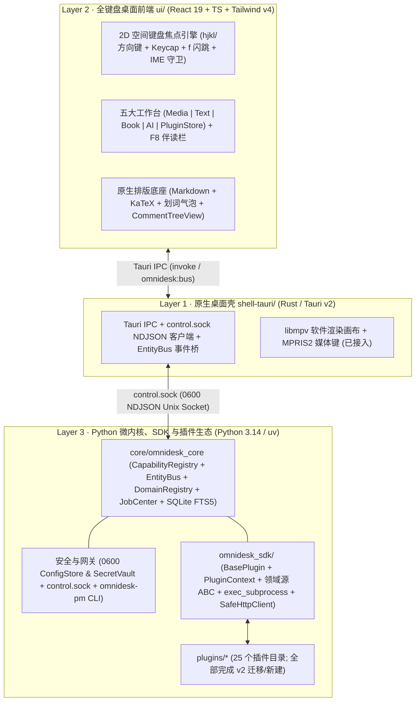

# 万象 · OmniDesk（v2）：极简三层架构 + 全键盘空间交互 + 零 ABI 纯 Python 插件体系

## 一、核心设计哲学与防膨胀铁律

OmniDesk v2 彻底告别 v1 时期「C++17 Borealis 手搓 UI + 22 个独立 CMake `.so` 二进制插件仓 + 头文件哈希连坐重编」的历史包袱，转向三层分离架构（工程预算初版目标为 `~16,000` 行以内、单文件上限 `<= 400` 行；当前随全功能测试与协议安全加固推进持续按模块化拆分重构）：

1. **零二进制插件 ABI（JSON / Pydantic 契约即唯一边界）**：
   - 彻底废除 C++ `.so` 动态库、`dlopen`、`OMNIDESK_DECLARE_PLUGIN`、`sdk_abi_signature` 编译期指纹与 `DsoViewLease`。
   - 所有站点接入、AI 路由、NAS 连接、字幕/电子书/PDF 处理与策展逻辑全部采用 **纯 Python（`3.14+`，`uv` 管理）** 编写，仅通过 `CapabilityRegistry`（版本化 JSON/Pydantic RPC）与 `EntityBus`（主题事件）解耦协作——改内核永不破坏插件，热重载无需重新编译。
2. **「键盘控制一切」的一等公民桌面体验**：
   - 完整继承并升级 **Paper `#F6F5F3`（纸感亮色）& Graphite `#181718`（石墨深色）** 视觉系统与无遮罩 `F8` 伴读栏。
   - 前端内置 **二维空间焦点引擎（2D Spatial Focus Engine）**：焦点绑定在稳定的业务 `item.id` 上（异步刷新绝不丢焦点），任何时刻都有清晰焦点环；支持 `h/j/k/l` 与方向键跨分栏几何跳转、显式键帽角标（`Ctrl+1..5` 工作台、确定性 `Alt+字母` 快捷页、`f` 全屏字母闪跳、`Ctrl+K` 命令面板、`F8` 伴读抽屉），并在 Fcitx5 / Rime 中文输入 `isComposing` 期间自动避让单键快捷键。
3. **原生硬解与 Web 排版职责分离**：
   - 由极薄原生壳内嵌 **`libmpv` 软件渲染画布** 与系统媒体键（MPRIS2）驱动音视频播放；**当前进度**：`shell-tauri/` 已实现真实 mpv 探测、`--input-ipc-server` 播放控制、libmpv 帧渲染回调、MPRIS2 D-Bus 服务与 UI 状态同步。
   - 双语文章、LaTeX 公式（KaTeX）、代码块高亮、可折叠嵌套评论树、EPUB/PDF 划词气泡（Selection API）交由现代 Web 排版引擎（`ui/`）承载，不再手搓 NanoVG 文本测量与纹理缓存。
4. **四条工程约束准则（防膨胀与同源复用）**：
   - **单文件上限 `<= 400` 行（目标红线）**：按职责拆分模块（当前 `core/`、`omnidesk_sdk/`、`shell-tauri/`、`ui/`、`plugins/` 中部分核心网关与数据文件已超 400 行，后续保持拆分收敛）。
   - **原生层零业务逻辑**：`shell-tauri/`（Rust）仅负责 Tauri v2 窗口、`control.sock` IPC 代理、事件转发与未来的 `libmpv` 帧渲染，不承载领域状态机（当前 `src/*.rs` 约 2.8k 行，已含安全校验与路径守卫）。
   - **单仓收编 + 公共底座复用**：插件已统一收编至主仓 `plugins/<plugin-id>/`（当前共 **25** 个插件目录，全部完成 v2 迁移/新建；`journals` 无 v1 源码，按 v2 规范新写）；`omnidesk_sdk/` 提供统一生命周期、领域源基类、进程组隔离、`SafeHttpClient` 与 `CookieSessionResolver`（含 SSRF/DNS rebinding、跨源脱敏与 HTTP CONNECT 环境代理）。
   - **兄弟项目活体同源引用**：`plugin-music`（`qwen_bridge.py`）已直接 `import` 本机 `/home/zhu/Projects/qwen-translator` 的音乐/双语歌词模块（`music_adam`、`music_lyrics`、`music_service`、`music_playback`）；其余插件按需接入（进行中）。

---

## 二、总体三层架构图

### 实际目录与职责对照表

| 目录 | 技术栈 | 当前实现状态与规模 | 核心职责边界 |
| :--- | :--- | :--- | :--- |
| **`shell-tauri/`** | Rust + Tauri v2 | IPC/事件桥、真实 mpv 播放控制、libmpv 软件渲染画布、MPRIS2 D-Bus 服务均已实现 | 原生窗口壳、`control.sock` 代理与安全脱敏、`EntityBus` 事件转发、嵌入式播放与系统媒体键 |
| **`ui/`** | React 19 + TypeScript + Tailwind v4 | 源码约 15.4k 行；`PluginStore`/`AiWorkbench`/`CompanionDock`/`Text`/`Book`/`Media` 均接 Tauri IPC | Paper/Graphite 主题、2D 空间焦点导航、五大工作台与 `F8` 伴读栏；在线源不可用时回退示例模式，并在工具栏显示 `LIVE` 徽标 |
| **`core/`** | Python 3.14 (`omnidesk_core`) | 源码约 7.7k 行；已实现并通过集成架构对齐 | 插件发现/热重载、`CapabilityRegistry`、`EntityBus`、`DomainRegistry`、`JobCenter`、`0600` 配置与密钥库、SQLite FTS5、`control.sock`（`domain.*` / `job.*` / `search.*`）与 `omnidesk-pm` CLI（16 个子命令，含 `curate` / `rehydrate` 与隔离依赖安装） |
| **`omnidesk_sdk/`** | Python 3.14 + Pydantic v2 | 基础契约、`SafeHttpClient`、`CookieSessionResolver` 均已实现 | `BasePlugin`、`PluginContext`、`MediaSource`/`TextSource`/`BookSource`、Pydantic 领域模型、`LocalConfigStore`/`LocalSecretVault`、`exec_subprocess`、安全 HTTP / Cookie 解析 |
| **`plugins/`** | Python 3.14（零编译插件） | 当前共 **25** 个插件目录，全部完成 v2 迁移/新建 | 内置纯 Python 插件（`plugin.json` + `plugin.py` + `tests/`）；含社区、博客、配方、期刊、媒体与书本全链路 |
| **`docs/`** | Markdown + JSON Schema | 3 份协议规范 + 3 份 JSON Schema | 插件接口协议、Web 会话桥接协议、AI 双模策展协议及 `docs/schemas/*.schema.json` |
| **`tests/`** | `pytest` + `pytest-asyncio` | 10 个核心/SDK/RPC 测试文件 | 验证插件生命周期、能力注册、流式协议、存储权限与多提供者调度 |

---

## 三、插件矩阵与松耦合协作模型

平台将插件分为 **能力底座（`provider`）**、**领域工作区（`workspace` / `hybrid`）** 与 **扩展（`extension`）**，严禁插件间直接硬编码互引，一律经由 `CapabilityRegistry` 与 `EntityBus` 协作（装了即联动，停用自动优雅降级）：

| 插件 ID | 类型 | 域 | 当前状态 | 职责边界 | 提供 / 消费的标准能力 |
| :--- | :--- | :--- | :--- | :--- | :--- |
| `plugin-magpie-agent` | `provider` | `core` | **已迁入 `plugins/`** | 探测本机 Magpie（`127.0.0.1:3425`）Harness/模型/配额，通过专属组 `group/omnidesk-active` 反向打穿路由，驱动内驻 AI 对话与策展 | **提供** `llm.router.v1`, `ai.agent.v1`, `ai.curation.v1`, `llm.chat.v1`, `llm.translate.v1`；**消费** `recommend.feed.v1`, `media.playlist.v1` |
| `plugin-ai-curator` | `hybrid` | `core` | **已新建于 `plugins/`** | 克隆同步 `obsidian-vault` 与 `music-daily` 回灌全量历史推荐，硬隔离 `daily_immutable` 与 `interactive_ephemeral` 双模前端反写 | **提供** `recommend.feed.v1` 及三域 `Source`；**消费** `vocab.sm2.v1` |
| `plugin-asr-funasr` | `provider` | `core` | **已迁入 `plugins/`** | 本地 Vulkan/CPU `FunASR SenseVoiceSmall` 独立子进程分块离线转写与断点续传 | **提供** `speech.asr.v1` |
| `plugin-demo` | `hybrid` | `core` | **已新建于 `plugins/`** | 最小 Protocol v2 参考示例插件（含能力调用与声明式工作台页签） | **提供** `demo.echo.v1` |
| `plugin-sub-hunter` | `provider` | `media` | **已迁入 `plugins/`** | SubHD / ASSRT 字幕检索安全解压、`ffsubsync` 自动音轨对齐与 SRT/VTT 双语翻译 | **提供** `subtitle.fetch.v1`, `subtitle.sync.v1`, `subtitle.translate.v1`；**消费** `web.cookies.v1`, `llm.translate.v1` |
| `plugin-sponsorblock` | `extension` | `media` | **已迁入 `plugins/`** | Bilibili (`bsbsb.top`) / YouTube (`sponsor.ajay.app`) K-匿名空降与恰饭片段标记跳过 | **提供** `player.timeline.v1` |
| `plugin-chrome-web` | `hybrid` | `text` | **已迁入 `plugins/`** | 托管原生 Chrome `--app` 阅读/登录窗、只读 Cookies SQLite 导入、CDP DOM 提取与同源请求代理（附 MV3 扩展骨架） | **提供** `web.embed.v1`, `web.cookies.v1`, `web.extract.v1`, `web.fetch.v1`；**消费** `llm.translate.v1` |
| `plugin-music` | `hybrid` | `media` | **已迁入 `plugins/`** | 复用 `qwen-translator` Apple Music / 双语歌词能力 + 国区曲库预检 + `ChatGPT Daily 5` 门禁写回 | **提供** `media.playlist.v1`, `media.source.v1`；**消费** `llm.translate.v1`, `llm.chat.v1` |
| `plugin-bilibili` | `workspace` | `media` | **已迁入 `plugins/`** | 推荐/动态/追番/直播、流解析、扫码鉴权与弹幕/双语字幕联动 | **注册** `MediaSource`（`provides: media.source.v1`）与 `bilibili.media.v1`；**消费** `web.cookies.v1`, `speech.asr.v1`, `llm.translate.v1`, `player.timeline.v1` |
| `plugin-youtube` | `workspace` | `media` | **已迁入 `plugins/`** | 订阅/搜索/频道、`yt-dlp` 流解析与边播边预译双语字幕 | **注册** `MediaSource`（`provides: media.source.v1`）与 `media.youtube.v1`；**消费** `llm.translate.v1`, `speech.asr.v1`, `player.timeline.v1` |
| `plugin-fnos-nas` | `hybrid` | `media` | **已迁入 `plugins/`** | 用户自配置挂载目录原盘硬解、受保护双语字幕原子写回、美剧台词切片跳播与阅读进度同步 | **提供** `nas.connection.v1`, `media.source.v1`, `media.local_match.v1`, `media.clip_jump.v1`, `book.sync.v1`；**消费** `subtitle.fetch.v1`, `subtitle.sync.v1` |
| `plugin-arr-imdb` | `workspace` | `media` | **已迁入 `plugins/`** | IMDb 榜单/详情 + Radarr / Sonarr 选片核验与下载队列管理 | **提供** `media.source.v1`；**消费** `media.local_match.v1` |
| `plugin-pdf-babeldoc` | `hybrid` | `book` | **已迁入 `plugins/`** | 基于 BabelDOC 的本地 PDF 版面识别、术语锁定与左右双栏对照生成 | **提供** `book.source.v1`, `book.bilingual_pdf.v1`；**消费** `llm.translate.v1` |
| `plugin-ebook` | `hybrid` | `book` | **已迁入 `plugins/`** | `.epub`/`.mobi`/`.azw3`/`.txt` 分页伴读、点词词源、长难句精读与 SM-2 间隔重复生词本 | **提供** `book.source.v1`, `vocab.sm2.v1`；**消费** `llm.chat.v1`, `llm.translate.v1`, `media.clip_jump.v1`, `book.sync.v1` |
| `plugin-zlib` / `plugin-annas-archive` | `hybrid` | `book` | **已迁入 `plugins/`** | Z-Library / Anna's Archive 搜书下载，支持联动 BabelDOC、EPUB 书架或飞牛 NAS | **提供** `book.search.v1`；**消费** `book.bilingual_pdf.v1`, `book.source.v1`, `book.sync.v1`, `nas.connection.v1`, `web.cookies.v1`, `web.fetch.v1` |
| `zhihu` / `v2ex` | `workspace` | `text` | **已迁入 `plugins/`（离线测试 + verify 通过）** | 知乎 / V2EX 信息流、公式代码块保真解析与可折叠评论树 | **提供** `text.source.v1`, `text.comments.v1`；**消费** `web.cookies.v1`, `web.fetch.v1`, `llm.translate.v1` |
| `linuxdo` / `shuiyuan` / `reddit` / `x` | `workspace` | `text` | **已迁入 `plugins/`（离线测试 + verify 通过）** | 各社区高信噪比信息流、公式代码块保真解析与可折叠评论树；WAN 请求走环境代理，回环/局域网保持直连 | **提供** `text.source.v1`, `text.comments.v1`；**消费** `web.cookies.v1`, `web.fetch.v1`, `llm.translate.v1` |
| `blog` / `feed-recipe` | `hybrid` | `text` | **已迁入 `plugins/`（离线测试 + verify 通过）** | 博主式个人博客订阅（RSS/Atom 发现 + HTML 回退 + Chrome 渲染）+ 声明式站点配方引擎 | **提供** `text.source.v1`, `blog.subscription.v1`, `feed.recipe.v1`；**消费** `web.cookies.v1`, `web.extract.v1`, `llm.translate.v1` |
| `journals` | `workspace` | `text` | **已按 v2 规范完成（离线 + 真实 arXiv 链路验证）** | arXiv / Nature RSS / bioRxiv / PubMed 论文流与 Crossref DOI 精读 | **提供** `text.source.v1`, `text.citation.v1`；**消费** `llm.translate.v1`, `web.extract.v1` |

---

## 四、`plugin-chrome-web`：为什么继续坚持「托管真 Chrome `--app` + MV3 扩展」？

对于重度反爬登录（Cloudflare Turnstile、jAccount SSO、2FA）以及出版商复杂交互网页阅读，托管系统原生 Chrome 比在应用内塞重型浏览器爬虫更干净：

1. **免商店签名直载 MV3 扩展**：通过 `--user-data-dir=<XDG_DATA_HOME>/omnidesk/chrome-profile --load-extension=resources/mv3-extension --app=<url> --class=omnidesk-reader` 拉起无地址栏纯净阅读窗，随系统自动更新且兼容 Wayland / Hyprland 分屏规则与 Fcitx5 输入法。
2. **当前实现与演进边界**：`plugins/plugin-chrome-web/` 已实现 Chrome `--app` 子进程生命周期管理、本地 MV3 扩展骨架（`plugins/plugin-chrome-web/resources/mv3-extension/`）、只读 Chromium `Cookies` SQLite 解析导入（`web.cookies.v1`）以及基于 loopback `127.0.0.1` CDP 的 `web.extract.v1` / `web.fetch.v1`；规划中还将进一步对接 `/home/zhu/Projects/qwen-translator` 网页翻译服务并完善 `Alt+Shift+T` 页面内双语注译闭环（**进行中**）。
3. **统一会话与下载回流底座**：在真实浏览器完成一次登录后，通过 `web.cookies.v1` / `web.fetch.v1` 反哺社区插件，作为高风控站点（Linux.do / 知乎 / X 等迁移后）的会话底座。

---

## 五、迁移与演进路线图（v1 C++ → v2 Python + React + Tauri）

> 注：v1 C++17 Borealis 源码已归档于 **`legacy-cpp` 分支并仅作参考**（`main` 分支已移除所有 v1 C++/CMake 目录）；外部插件仓库位于 `/home/zhu/Projects/omnidesk-plugin-*`，**`journals` 暂无源码**。新功能开发与插件迁移按以下 v2 阶段推进：

1. **Stage 1：v2 核心骨架与全键盘空间工作台闭环（已完成）**
   - 已落地 `core/`（`omnidesk_core` + `control.sock` + `omnidesk-pm` 基础命令）、`omnidesk_sdk/`、`tests/`、`ui/`（Paper & Graphite 主题 + 2D 空间键盘焦点引擎 + 五大工作台 + `F8` 伴读栏）与 `shell-tauri/`（Tauri v2 + `control.sock` IPC 代理 + `EntityBus` 事件桥）。
   - `libmpv` 软件渲染嵌入、MPRIS2、`SafeHttpClient`、`CookieSessionResolver`、插件隔离依赖安装与 Text/Book/Media 在线源接入均已实现；真实出帧测试由 `OMNIDESK_MPV_E2E=1` 在 CI 中强制执行。
2. **Stage 2：核心底座与双模 AI 策展率先就位（已迁入 `plugins/`）**
   - 已实现 `plugin-magpie-agent`、`plugin-ai-curator`（双仓历史回灌 + 每日/交互双模隔离）、`plugin-music`（直接复用 `qwen-translator` 的 `music_adam` / `music_lyrics` 等模块 + Apple Music 写回门禁）及 `plugin-demo`。
   - `plugin-magpie-agent` 已注册 `context.collect.v1`：按白名单并发收集网页、电子书、字幕、语音转写、文本/媒体源上下文，支持 `provider_plugin_id` 指定来源，剥离 secret/token/cookie，并支持 `ai.agent.v1` 的 `context_refs` 自动注入；MCP 提供 `omnidesk_collect_context` / `omnidesk_recommend` / `omnidesk_download_book`。副作用动作要求 `confirm` + `reason` 并写入 0600 审计日志。
3. **Stage 3：书本伴读、浏览器桥接与文字社区全部就位（已完成）**
   - 已迁入 `plugin-chrome-web`、`plugin-ebook`、`plugin-pdf-babeldoc`、`plugin-zlib`、`plugin-annas-archive`。
   - `zhihu`、`v2ex`、`linuxdo`、`shuiyuan`、`reddit`、`x`、`blog`、`feed-recipe` 均已迁入并通过离线测试与 `omnidesk-pm verify`；`journals` 按 v2 规范完成 arXiv / Nature / bioRxiv / PubMed / Crossref 链路。
4. **Stage 4：影视源、飞牛 NAS 与原生播放联动全部就位（已完成）**
   - 已迁入 `plugin-fnos-nas`、`plugin-bilibili`、`plugin-youtube`、`plugin-sub-hunter`、`plugin-sponsorblock`、`plugin-asr-funasr`、`plugin-arr-imdb`；libmpv 嵌入式播放、MPRIS2 媒体键与 UI 真实状态同步已接通。
