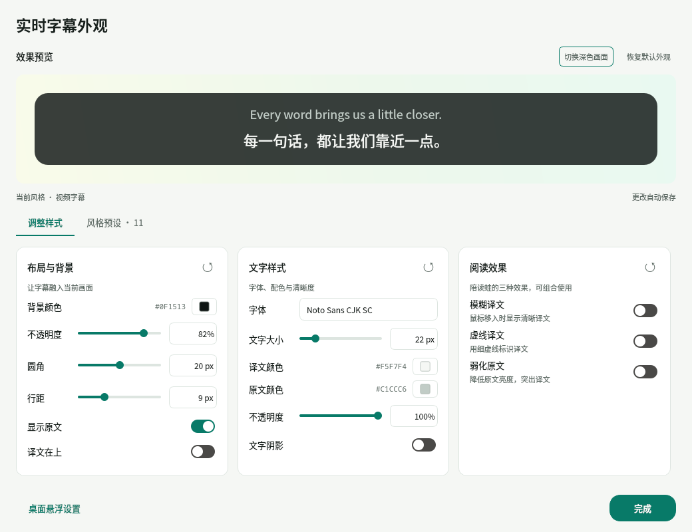
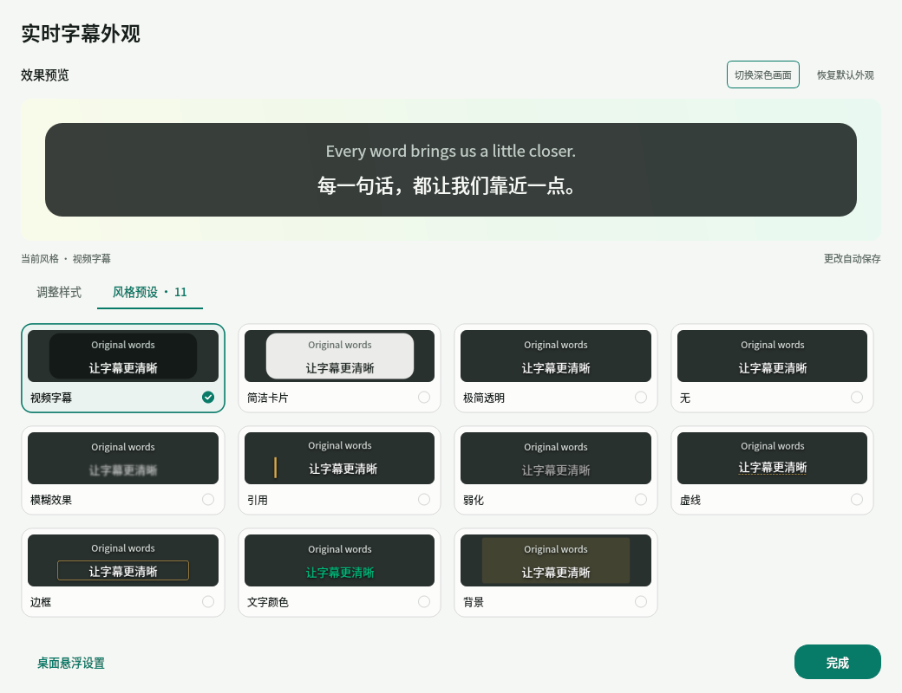
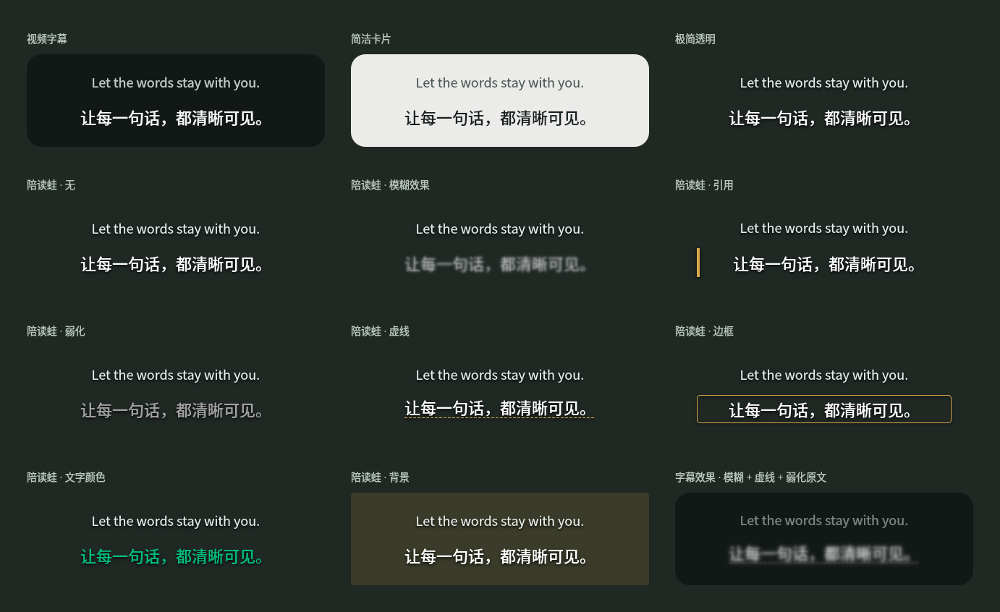

# 字幕与歌词外观

实时翻译：在「偏好设置 → 实时字幕外观」展开设置，或在悬浮字幕的「设置 → 外观…」打开编辑器。

音乐：在「音乐与歌词 → 外观与预设…」打开独立设置窗口，点击「打开悬浮歌词」显示独立窗口。歌词窗口与实时字幕可以同时显示，分别记住外观和窗口尺寸。

歌词默认字号为 **24 px**。音乐页和外观窗口都有「恢复默认」入口，只恢复歌词外观与悬浮选项，不清除歌词缓存或翻译配置。11 种风格预设集中在独立外观窗口内；设置不再向下撑开音乐页面，窗口高度受当前屏幕限制，空间不足时滚动内容。

音乐页提供 **悬浮歌词鼠标穿透**。开启后歌词仍显示，悬浮工具栏隐藏，点击、滚轮和触摸交给后面的窗口；回主页面取消勾选即可恢复拖动和外观操作。穿透状态会保存，切换预设保留此选项。模糊译文的悬停显示需要先关闭穿透。应用使用 Qt 的 `WindowTransparentForInput`，并已在本机 Wayland 验证空输入区域的提交和恢复。[Qt 窗口输入标志](https://doc.qt.io/qt-6.8/qt.html#WindowType-enum)

穿透同时启用 `WindowDoesNotAcceptFocus`，并主动刷新窗口，让静止或暂停的歌词也能及时提交新的输入区域。Hyprland 0.55+ 还会针对本进程的悬浮窗口同步 `no_focus`，关闭穿透后恢复接收焦点。2026-11-02 在本机 Hyprland 0.56.2 / Qt 6.12 原生 Wayland 下，用两个临时窗口验证：先让悬浮窗获得焦点，再开启穿透，实际鼠标点击和滚轮都到达后方窗口；关闭后恢复悬浮窗操作，再开启仍正常。测试未修改桌面配置。[Hyprland 窗口规则](https://wiki.hypr.land/0.56.0/Configuring/Basics/Window-Rules/)

「布局与背景」新增 **背景完全透明**：开启后隐藏字幕底板，保留文字与文字效果；Hyprland 下同时去掉窗口模糊、阴影和边框。关闭后恢复原来的底板设置。切换风格预设保留此开关。工具栏仍在鼠标移入时显示，收起设置并移开鼠标后自动隐藏。

歌词默认开启 **适配屏幕**：打开时使用当前屏幕约 60% 的可用宽度（通常为 420–1600 个逻辑像素，小屏按可用空间缩小），高度随内容变化，靠下居中。支持显示缩放和屏幕工作区边距；切换显示器或工作区尺寸变化时重新适配。关闭后保留手动尺寸，下次启动恢复保存的窗口大小。普通 Wayland 桌面的绝对定位仍由桌面决定，Hyprland 0.55+ 使用其窗口接口完成定位。

## 外观编辑器

编辑器参考陪读蛙的「顶部预览 + 分组卡片」布局：预览固定在上方，可以切换深浅画面；下方按「布局与背景」「文字样式」「阅读效果」分组。透明度等数值用滑块调整，也能直接输入。每组右上角可单独恢复默认。

「风格预设」展示全部 11 张实际效果缩略图。选择后可切回「调整样式」继续微调；窄窗口自动改为单列并滚动设置区。极小窗口允许整个编辑区滚动，底部「完成」按钮保持可达。桌面悬浮设置在独立帮助窗口中打开。

## 整套预设与微调

选择预设会一次套用配好的字体、字号、颜色、背景不透明度、圆角、间距及双语顺序，之后可以继续微调。预览使用与悬浮窗口相同的绘制组件，设置立即生效并保存在本机。切换整套预设会重置上次的微调；「恢复默认外观」只重置当前类别。

保留原有「视频字幕、简洁卡片、极简透明」，完整加入陪读蛙网页译文的八种预设：

| 预设 | 效果 |
| --- | --- |
| 无 | 不附加译文装饰 |
| 模糊效果 | 译文模糊 4 px 并弱化，鼠标移到译文上时清晰显示 |
| 引用 | 译文左侧金色竖线 |
| 弱化 | 译文使用灰色 |
| 虚线 | 译文下方金色虚线 |
| 边框 | 金色细框与小圆角 |
| 文字颜色 | 绿色译文 |
| 背景 | 15% 不透明度的金色背景 |

另外提供陪读蛙的全部三个字幕模板，作为可叠加开关：

- **模糊译文**：译文模糊 6 px，悬停译文时恢复清晰；不改变所选文字透明度。
- **虚线译文**：使用当前文字颜色的虚线，可与其他效果叠加。
- **弱化原文**：原文保留 60% 的所选文字不透明度。

只有原文、尚无译文时，模糊译文与虚线译文效果不隐藏或装饰唯一的原文；等待提示也保持清晰。

可调参数包括字体、主文字号、原文 / 译文 / 背景颜色、背景不透明度、文字不透明度、圆角、原译行距、原文可见性、原译顺序和文字阴影。背景不透明度只改变字幕底板，不改变文字；0% 为完全透明。预览背板用于检查透明效果，不会成为桌面窗口的背景。

音乐页与悬浮歌词共用设置。页内透明预设根据应用深浅主题适配文字以便阅读；手动指定颜色始终优先。悬浮歌词只跟随播放器提供的时间轴，纯文本歌词不会自动滚动冒充同步字幕。

## 桌面兼容性

字幕窗口支持系统拖动、右下角缩放和隐藏。背景透明度由应用绘制，不依赖桌面的整窗透明度功能。Hyprland 0.55+ 可自动让本应用的字幕 / 歌词窗口浮动，并按置顶开关设置跨工作区固定；应用不改写桌面配置。其他 Wayland 桌面上的置顶及全屏覆盖由合成器决定。详见 [Wayland 与 Hyprland](OVERLAY_WAYLAND.zh-CN.md)。

## 参考来源与适配

预设名称、装饰参数及交互依据 Read Frog（陪读蛙）提交 `5c5337624f148bd2c62d8d9496c9e5f06d7c7d8f` 的 [网页译文样式](https://github.com/mengxi-ream/read-frog/blob/5c5337624f148bd2c62d8d9496c9e5f06d7c7d8f/src/assets/styles/custom-translation-node.css)、[主题色](https://github.com/mengxi-ream/read-frog/blob/5c5337624f148bd2c62d8d9496c9e5f06d7c7d8f/src/assets/styles/host-theme.css)及[字幕模板](https://github.com/mengxi-ream/read-frog/blob/5c5337624f148bd2c62d8d9496c9e5f06d7c7d8f/src/utils/constants/subtitles.ts)。其项目许可证为 GPL v3。

编辑器布局参考[陪读蛙官方字幕教程](https://www.readfrog.app/zh/docs/video-subtitles)中的样式设置界面；在 Qt 桌面端增加可视化预设页和独立歌词配置。

这里按这些视觉参数独立实现 Qt 绘制，未嵌入 Read Frog 的 React 或 CSS 文件。网页预设本身只定义局部译文效果；本应用将它们与可用于桌面的基础字体、双语布局和阴影组合，作为一键预设。金色、绿色从 OKLCH 换算成 sRGB；虚线跟随每行实际文字宽度绘制，支持换行与居中，边框沿 Qt 标签边缘绘制。网页和原生窗口的排版与模糊算法不同，因此属于原生适配，不是浏览器像素级复制。
