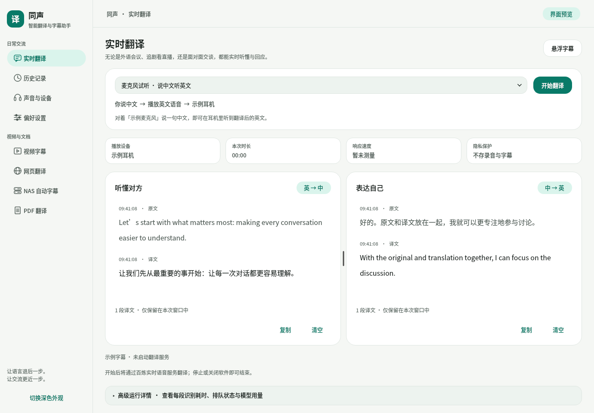
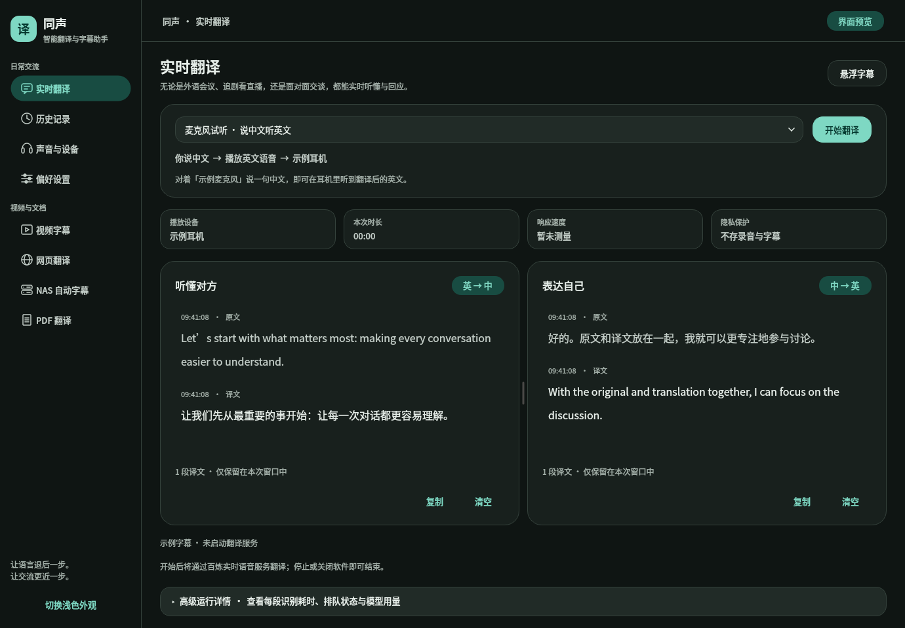
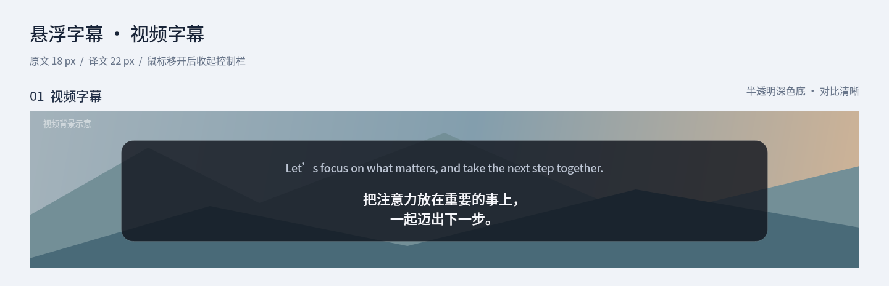

# 桌面界面

本次界面依据 `meeting-translator-codex-handoff.zip` 的页面规范，并按后续要求优化视觉风格、加入深浅主题。包内图片是旧版功能参考；Figma 远程画面暂不可访问，因此不声称逐像素复刻。

- **实时翻译**：翻译模式、开始/结束、音频去向、会话时长和双向字幕。原文与译文按方向分别显示，支持复制。开始新会话会清空上次窗口字幕。
- **历史记录**：搜索与最近 7/30 天筛选；本机仅保存最近 100 次会话的开始时间、模式、时长、设备、完成/中断状态。
- **声音与设备**：耳机/扬声器、麦克风、双语音色、刷新与试听入口；默认优先匹配系统默认输出/输入设备、蓝牙耳机或上次记住的选择，不假定特定耳机型号。本地语音识别加速、收音灵敏度与线上会议连接说明收纳在“高级设置”中。
- **偏好设置**：界面外观、字幕与文档翻译服务、实时语音同传服务；并发任务数、思考深度、接口协议、提示词预览及隐私说明收纳在“高级设置”次级区域。
- **首次使用**：连接 API → 选择设备 → 麦克风试听；已有 Key 的用户直接进入工作空间，也可在偏好设置重新打开引导。
- **悬浮字幕**：无边框、半透明深底圆角窗口。原文在上默认 18 px，译文在下默认 22 px、稍粗；窗口设置还可切换浅色卡片与透明文字外观。鼠标移开后自动收起控件，移入即可设置、隐藏或清空；拖动字幕移动窗口，右下角调整宽度。新原文到达时保留上组译文，完成后按句子编号配对切换，避免闪回与长时间看不到译文。
- **只有字幕模式**：FunASR GPU 本地识别，默认 Luna 文本翻译；也可自行接入兼容 API 或仅显示原文。实时翻译页提供“快速字幕 / 完整优先”两个响应选项。快速模式让原文先更新，保留旧译文时明确标注；完整优先维持原译文成对更新。下方分开显示识别、翻译和排队耗时。见[本地字幕模式说明](LOW_COST_PLAN.zh-CN.md)。

主题令牌集中在 `ui_theme.py`，页面组件在 `desktop_ui.py`，后台进程调度及窗口状态在 `native_app.py`。保留 `native_worker.py`、`duplex.py`、`credentials.py` 的翻译、路由和密钥库接口。

主界面与安卓端统一为 Material 风格，优先使用 Noto Sans CJK SC / Noto Sans 无衬线字体。共享颜色、圆角及间距由 `design/material-theme.json` 生成，见[三端统一规范](MATERIAL_UI.zh-CN.md)。

字幕面板支持复制与清空；分隔条可拖动，也可聚焦后用方向键调整、Home 或双击恢复均分，横竖布局分别记忆比例。Ctrl+1 至 Ctrl+7 切换页面，F9 显示或隐藏悬浮字幕。

标准桌面使用完整侧栏和左右字幕；小于 1180 px 收起侧栏文字，小于 900 px 上下排列字幕。小窗口可滚动，避免字幕被压缩到不可读。语音同传延迟未由后端测量，显示“暂未测量”；本地字幕模式显示实际识别耗时以及分段结束到译文的耗时。设备或 ASR 失败会停止会话；字幕文本翻译失败时继续显示原文。

滚轮经过收起的下拉框或数字输入框时继续滚动页面，即使控件已有焦点也不会修改设置。下拉选项需点击展开后选择，长列表仍可用滚轮浏览；数字支持直接输入、方向键和增减按钮。主界面、视频字幕和悬浮字幕设置统一采用此行为。

会话元数据和界面偏好通过 QSettings 保存；API Key 仍只保存于系统密钥库。不会将原始音频或字幕写入历史记录。

## 预览

预览为使用示例设备名称渲染的待机界面。





悬浮字幕最终外观：半透明深底，原文 18 px、译文 22 px。背景为示意视频画面，控件收起。



## 验证

```bash
python3 scripts/test.py --suite qt
```

测试使用本地替身工作进程，通过真实 QProcess 信号验证启动/停止、进程错误、窗口关闭、凭据脱敏、历史持久化、主题切换、导航、缩放与悬浮字幕。不访问密钥库，不发送音频，不调用付费 API。界面检查尺寸包括 1380×900、1000×780、800×800、680×660。
